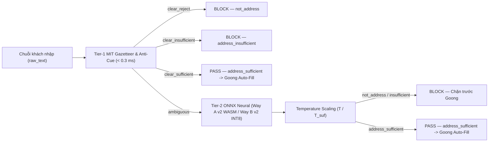
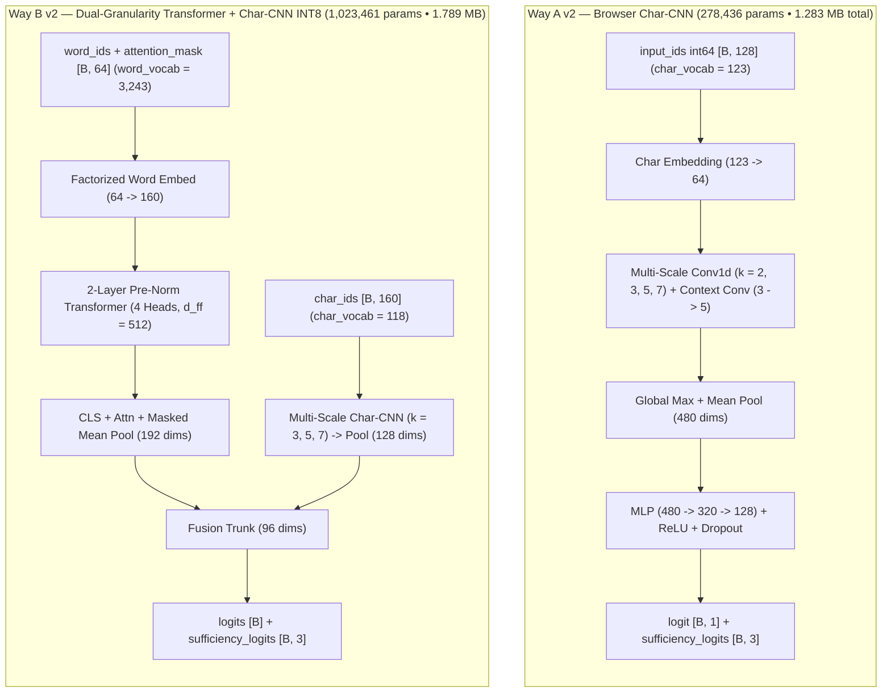
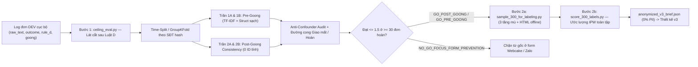

# Laya Address VN

Hệ thống cổng lọc thông minh và phân loại độ đủ địa chỉ Việt Nam đến cấp **Xã/Phường** trước bước tự điền (Goong Auto-Fill), gồm 2 kiến trúc song song (**Way A v2** chạy 100% trên trình duyệt bằng ONNX WASM `0đ` server; **Way B v2** chạy FastAPI CPU + ONNX INT8) cùng bộ công cụ đo trần dữ liệu thật **offline 100%** ([`ceiling_audit/`](ceiling_audit/README.md)).

> **Chính sách bảo mật dữ liệu:** Repository này không chứa dữ liệu khách hàng thật hay số điện thoại. Toàn bộ danh mục hành chính sử dụng nguồn mở MIT; mọi script kiểm chứng trên đơn hàng thật trong `ceiling_audit/` đều chạy cục bộ và tự động bị loại khỏi Git qua [`.gitignore`](.gitignore).

---

## 1. Kiến trúc hệ thống (Diagrams)

### Luồng quyết định Hybrid 2 Tầng (`Tier 1 Gazetteer -> Tier 2 ONNX Neural`)



### So sánh kiến trúc Neural bên trong Way A v2 & Way B v2



### Quy trình đo trần & kiểm chứng đơn hàng thật offline (`ceiling_audit/`)



---

## 2. Thông số kỹ thuật & hiệu năng triển khai (v2)

| Thông số | Way A v2 (`way_a_browser_onnx_v2`) | Way B v2 (`way_b_backend_api_v2`) |
|---|---|---|
| **Môi trường chạy** | Trình duyệt WASM (`onnxruntime-web@1.20.1` vendored, `0đ` server, 0 CDN) | Backend FastAPI CPU (`onnxruntime` INT8 `QUInt8`, không `torch`/pickle) |
| **Kiến trúc Neural** | `LayaAddressSufficiencyCharCNN` | `LayaDualGranularitySufficiencyModel` (2L Transformer + Char-CNN) |
| **Số tham số** | `278,436` | `1,023,461` |
| **Đầu vào ONNX** | `input_ids` (`int64`, `[B, 128]`, `char_vocab = 123`) | `word_ids` (`[B, 64]`, `vocab = 3,243`), `attention_mask`, `char_ids` (`[B, 160]`, `118`) |
| **Đầu ra ONNX** | `logit` (`[B, 1]`) + `sufficiency_logits` (`[B, 3]`) | `logits` (`[B]`) + `sufficiency_logits` (`[B, 3]`) |
| **Dung lượng model / gói** | `1,118,184 B` ONNX + `221,796 B` gazetteer = **`1.283 MB`** (`<= 2 MB`, Opset 14) | FP32 `3.940 MB` -> INT8 **`1.789 MB`** (`-54.59%`, Opset 17) |
| **Calibration (`T`, `threshold`, `T_suf`)** | `T = 1.61869` • `thr = 0.500` • `T_suf = 1.62280` | `T = 1.25809` • `thr = 0.520` • `T_suf = 1.28803` |
| **ECE Post-Cal trên tập Test nội bộ** | Bin `0.00698` • 3-Cls `0.00365` (`n = 9,001`) | INT8 Bin `0.00442` • 3-Cls `0.00498` (`n = 7,500`) |
| **Độ trễ CPU đơn lẻ (600 hold-out)** | `p50 = 0.015` • `p95 = 0.295` • **`p99 = 0.381 ms`** (`hybrid`) | `p50 = 0.079` • `p95 = 0.455` • **`p99 = 1.097 ms`** (`hybrid`; batch-32: `4,044.3 req/s`) |

---

## 3. Kết quả kiểm thử độc lập & kiểm toán rò rỉ (`benchmark_v2/`)

### Bộ Hold-Out độc lập 600 ca (`seed=20261122`, khác bộ sinh & khác seed huấn luyện)

Phân bố nhãn chuẩn: `200` `not_address` (`100` rác/chat + `100` hard negative) / `120` `address_insufficient` / `280` `address_sufficient` (`100` đầy đủ + `180` địa chỉ ngắn hợp lệ theo 6 kiểu viết).

| Mô hình & Chế độ | 3-Cls Acc | Macro-F1 | Binary Acc | Binary F1 | Chặn nhầm địa chỉ ngắn | Recall `insufficient` | Chặn rác | Chặn Hard-Neg | ECE (Bin / 3-Cls) | CPU `p99` |
|---|---:|---:|---:|---:|---:|---:|---:|---:|---:|---:|
| `Way A v2 (heuristic_only)` | `96.00%` | `0.9485` | `99.83%` | `0.9982` | `0.56%` (`1/180`) | `98.33%` | `100.00%` | `100.00%` | `0.0142 / 0.0338` | `0.249 ms` |
| `Way A v2 (model_only)` | `91.17%` | `0.9048` | `93.50%` | `0.9342` | `1.67%` (`3/180`) | `93.33%` | `91.00%` | `81.00%` | `0.0522 / 0.0488` | `0.561 ms` |
| **`Way A v2 (hybrid)`** | **`98.33%`** | **`0.9791`** | **`99.67%`** | **`0.9964`** | **`0.56%` (`1/180`)** | **`100.00%`** | **`100.00%`** | **`99.00%`** | **`0.0147 / 0.0157`** | **`0.381 ms`** |
| `Way B v2 (heuristic_only)` | `99.67%` | `0.9958` | `99.83%` | `0.9982` | `0.56%` (`1/180`) | `100.00%` | `100.00%` | `100.00%` | `0.0144 / 0.0227` | `0.358 ms` |
| `Way B v2 (model_only)` | `89.33%` | `0.8898` | `91.00%` | `0.9097` | `4.44%` (`8/180`) | `93.33%` | `86.00%` | `76.00%` | `0.0660 / 0.0650` | `1.164 ms` |
| **`Way B v2 (hybrid)`** | **`99.83%`** | **`0.9980`** | **`99.83%`** | **`0.9982`** | **`0.56%` (`1/180`)** | **`100.00%`** | **`100.00%`** | **`100.00%`** | **`0.0080 / 0.0152`** | **`1.097 ms`** |

### Phân rã 6 kiểu địa chỉ ngắn hợp lệ (180 ca) & Ma trận nhầm 3×3 (`hybrid`)

| Kiểu viết ngắn hợp lệ (`30` ca / nhóm) | Chặn nhầm Way A v2 (`hybrid`) | Chặn nhầm Way B v2 (`hybrid`) |
|---|---:|---:|
| `no_prefix_comma` (`"Lộc Thạnh, Lộc Ninh"`) | `0.0%` (`0/30`) | `0.0%` (`0/30`) |
| `no_prefix_no_comma` (`"Lộc Thạnh Lộc Ninh"`) | `0.0%` (`0/30`) | `0.0%` (`0/30`) |
| `unaccented_lower` (`"loc thanh loc ninh"`) | `0.0%` (`0/30`) | `0.0%` (`0/30`) |
| `abbreviated` (`"x. Lộc Thạnh h. Lộc Ninh"`) | `0.0%` (`0/30`) | `0.0%` (`0/30`) |
| `ward_district_province` (`"Xã, Huyện, Tỉnh"`) | `0.0%` (`0/30`) | `0.0%` (`0/30`) |
| `ward_province_2tier` (`"Nà Hang, Tuyên Quang"`) | `3.3%` (`1/30`) | `3.3%` (`1/30`) |

- **Ma trận nhầm 3×3** (`["not_address", "address_insufficient", "address_sufficient"]`):
  - **Way A v2 (`hybrid`):** `[[191, 8, 1], [0, 120, 0], [0, 1, 279]]` (`FP = 1`, `FN = 1`)
  - **Way B v2 (`hybrid`):** `[[200, 0, 0], [0, 120, 0], [0, 1, 279]]` (`FP = 0`, `FN = 1`)
- **11 chuỗi rác bắt buộc** (`"73"`, `"10"`, `"K"`, `"Hi"`, `"Ok"`, `"Jean"`, `"Xom"`, `"Thôn 7"`, `"Xin giá"`, `"ngõ 12"`, `"Cho mình 3 chai nướng BBQ"`): bị chặn **`11/11`** ở cả 2 phương án.

### Tiến bộ `v1 -> v2` & Báo cáo kiểm tra rò rỉ (`leakage_report.json`)

| Chỉ tiêu đối chiếu | Way A (`v1 -> v2`) | Way B (`v1 -> v2`) |
|---|---|---|
| **Benchmark 90 ca cũ (`hybrid`)** | `87/90 (96.67%)` -> **`89/90 (98.89%)`** | `86/90 (95.56%)` -> **`89/90 (98.89%)`** |
| **Sau loại 5 ca rò rỉ v1 (`85` ca sạch)** | `—` -> **`84/85 (98.82%)`** | `—` -> **`84/85 (98.82%)`** |
| **Trùng nguyên văn / chuẩn hóa với 90 ca** | **`5` ca (`C01, NN02, NN03, NN09, NN10`) -> `0`** | **`0 -> 0`** |
| **Trùng nguyên văn / chuẩn hóa với 600 hold-out** | **`0`** (`71,999` câu train) | **`0`** (`60,000` câu train) |

> **Giới hạn đã kiểm chứng trên đơn hàng thật:** Các chỉ số trên được đo trên dữ liệu tổng hợp. Trên tập 34.263 đơn thật ngoại tuyến của đối tác, phần hoàn nền còn sót sau Luật D nằm quanh ~15% (chủ yếu do khách đổi ý / không nghe máy), nên tỷ lệ `giao mất / hoàn` cần kiểm trực tiếp bằng bộ công cụ [`ceiling_audit/`](ceiling_audit/README.md) để quyết định hướng **Post-Goong Verification (v3)** hay tối ưu form đầu vào.

---

## 4. Cấu trúc dự án & Nguồn danh mục hành chính

| Thư mục | Vai trò | Tài liệu / Kiểm tra |
|---|---|---|
| `way_a_browser_onnx/` | Way A v1 — Browser ONNX Char-CNN (bản gốc) | [`way_a_browser_onnx`](way_a_browser_onnx/) |
| `way_b_backend_api/` | Way B v1 — FastAPI Transformer+CNN INT8 (bản gốc) | [`way_b_backend_api`](way_b_backend_api/) |
| `way_a_browser_onnx_v2/` | **Way A v2** — Dual-head ONNX + MIT Gazetteer + `ort-web@1.20.1` | [`MODEL_CARD.md`](way_a_browser_onnx_v2/MODEL_CARD.md) |
| `way_b_backend_api_v2/` | **Way B v2** — Dual-head INT8 ONNX FastAPI + MIT Gazetteer | [`MODEL_CARD.md`](way_b_backend_api_v2/MODEL_CARD.md) |
| `shared_data/` | Danh mục hành chính MIT (`63` tỉnh, `656` huyện, `7,044` xã; `221,796 B`) | [`PROVENANCE.json`](shared_data/PROVENANCE.json) |
| `benchmark/` | Bộ kiểm chuẩn 90 ca v1 & báo cáo baseline | [`shared_eval_report.json`](benchmark/shared_eval_report.json) |
| `benchmark_v2/` | Hold-out 600 ca, kiểm tra rò rỉ & acceptance tests (`3/3` pass) | [`eval_report_v2.json`](benchmark_v2/eval_report_v2.json) |
| `ceiling_audit/` | Công cụ Bước 1 (đo trần Pre/Post-Goong) & Bước 2 (300 mẫu IPW offline) | [`README.md`](ceiling_audit/README.md) |

- **Nguồn danh mục hành chính:** [`tranngocminhhieu/vietnamadminunits`](https://github.com/tranngocminhhieu/vietnamadminunits) (**MIT License**, xem [`LICENSE_vietnamadminunits.txt`](shared_data/LICENSE_vietnamadminunits.txt)), tổng hợp từ GSO `2025-07-18` (`10,035` dòng 3 cấp) + bộ sáp nhập 2025 (`3,321` dòng 2 cấp); file đóng gói [`vn_admin_gazetteer.json`](shared_data/vn_admin_gazetteer.json) có `SHA-256 = 11096369768889e62dc9b11f7065d9a414452207511ad4c87ad29c406732cc79`.

---

## 5. Lệnh chạy nhanh

```powershell
# 1. Chạy lại toàn bộ Acceptance Tests của bản v2 (3/3)
cd "laya_address_vn\benchmark_v2"
..\way_b_backend_api_v2\.venv\Scripts\pytest.exe -v --basetemp=".pytest_tmp" test_v2_acceptance.py

# 2. Tự kiểm tra bộ đo trần & lấy mẫu 300 ca trên dữ liệu tổng hợp (5/5)
cd "..\ceiling_audit"
.\.venv\Scripts\pytest.exe -v --basetemp=".pytest_tmp" tests\test_ceiling_audit.py

# 3. Đo trần Bước 1 trên file DEV thật ở máy cục bộ (xem thêm ceiling_audit/README.md)
.\.venv\Scripts\python.exe ceiling_eval.py --data "D:\path\to\dev_orders.csv" --score-v2 --output-dir "outputs\step1_dev"
```
