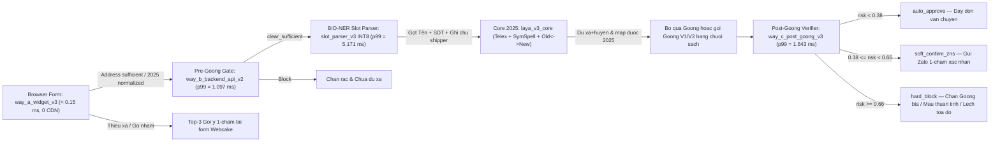
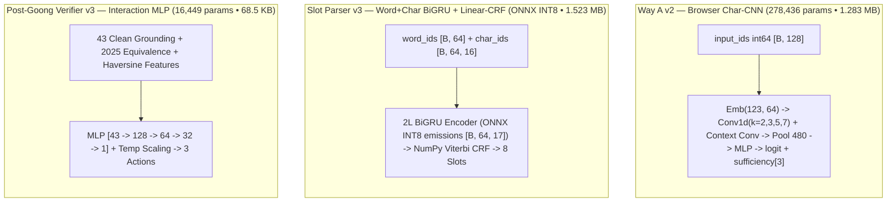
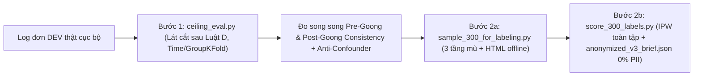

# Laya Address VN (`v2.0` + `v3.0 Suite`)

Hệ thống xử lý, chuẩn hóa & kiểm chứng địa chỉ giao hàng Việt Nam theo **cả 2 hệ hành chính (63 tỉnh cũ <-> 34 tỉnh 2 cấp 2025)** — từ **Widget trình duyệt 0đ server** (`way_a_widget_v3`, `way_a_browser_onnx_v2`) đến **Backend CPU ONNX Suite** (`laya_v3_core`, `slot_parser_v3`, `way_b_backend_api_v2`, `way_c_post_goong_v3`) và bộ công cụ **đo trần đơn thật offline 100%** ([`ceiling_audit/`](ceiling_audit/README.md)).

> **Chính sách dữ liệu:** Repository này không chứa dữ liệu khách hàng thật hay SĐT. Mọi danh mục hành chính đều dùng nguồn mở MIT; mọi script kiểm chứng trên đơn thật trong `ceiling_audit/` đều chạy cục bộ và bị loại khỏi Git qua [`.gitignore`](.gitignore).

---

## 1. Kiến trúc hệ thống `v3.0` (Diagrams)

### Đường ống hoàn chỉnh Web -> Backend -> Goong V1/V2 -> Giao hàng (`v3.0`)



### So sánh kiến trúc bên trong các mô hình ONNX (`v2` & `v3`)



### Quy trình đo trần & gán nhãn 300 mẫu đơn thật offline (`ceiling_audit/`)



---

## 2. Kết quả kiểm chứng các mô-đun mới `v3.0`

| Mô-đun `v3.0` | Nhiệm vụ | Dung lượng / Runtime | Bộ kiểm chuẩn độc lập | Kết quả kiểm chứng & Độ trễ CPU |
|---|---|---|---|---|
| **`way_a_widget_v3`** (`@laya/address-vn-widget`) | SDK nhúng Webcake `<laya-address-input>`, sửa Telex, SymSpell 1-edit, Top-3 gợi ý xã, đổi 2025 ngay tại trình duyệt | JS UMD (`0` CDN) + `1.283 MB` ONNX + `1.075 MB` Converter JSON | `tests/test_widget_v3.mjs` (`13/13` PASS) | Init `5.25 ms` • **Trung bình `0.0825 ms`/chuỗi** (500 mẫu) |
| **`laya_v3_core`** (`telex_fuzzy` + `converter_2025`) | Sửa Telex/VNI, SymSpell 1-edit, chuẩn hóa 63 tỉnh cũ <-> 34 tỉnh 2025 (+ 5 đặc khu), Haversine tâm xã | Pure Python stdlib (`0` dep) + `1.075 MB` `vn_admin_v3_converter.json` | `tests/test_v3_core.py` (`36/36` PASS) | Build `32.45 ms` • **Trung bình `0.1847 ms`/chuỗi** (500 mẫu) |
| **`slot_parser_v3`** (BIO-NER 17 nhãn) | Bóc tách 8 thực thể (`HNO, STR, WAR, DIS, PRO, PER, PHN, NOTE`), tự tạo chuỗi sạch gửi Goong | **ONNX INT8 `1.523 MB`** (`-44.7%` vs FP32) + NumPy Viterbi CRF (`0` `.pt`) | Hold-out độc lập `500` ca (`seed=20261201`) + `10/10` pytest PASS | Token Acc **`98.58%`** • Macro Entity F1 **`0.9770`** • Negative FP `0.0%` • **`p99 = 5.171 ms`** |
| **`way_c_post_goong_v3`** (Xác minh Hậu-Goong) | Bắt Goong bịa cấp cha, mâu thuẫn tỉnh/huyện, lệch tọa độ Haversine; bỏ qua khác biệt cũ <-> 2025; trả 3 hành động | **ONNX FP32 `68.53 KB`** (`16,449` params, `0` `.pt`) + `43` đặc trưng sạch | Test `6,000` ca (`seed=301`) & Hold-out `600` ca (`seed=20261199`) + `12/12` pytest PASS | Test `PR-AUC=0.9998`, Hold-out `PR-AUC=1.000`, `ECE=0.0044`, `legacy_2025_false_alarm=0.0–0.18%` • **`p99 = 1.643 ms`** |

### Chi tiết F1 từng thực thể trên Hold-Out 500 ca — `slot_parser_v3` (ONNX INT8 + NumPy Viterbi)

| Thực thể | Ý nghĩa | Hold-out Support | Precision | Recall | F1 |
|---|---|---:|---:|---:|---:|
| `HNO` | Số nhà / hẻm / căn hộ | `234` | `1.0000` | `1.0000` | **`1.0000`** |
| `STR` | Tên đường / thôn / ấp / chung cư | `311` | `0.9709` | `0.9646` | **`0.9677`** |
| `WAR` | Xã / Phường / Thị trấn | `347` | `0.9335` | `0.9712` | **`0.9520`** |
| `DIS` | Quận / Huyện / Thị xã | `348` | `0.9708` | `0.9569` | **`0.9638`** |
| `PRO` | Tỉnh / Thành phố | `298` | `0.9834` | `0.9933` | **`0.9883`** |
| `PER` | Tên người nhận kèm tiền tố | `194` | `0.9461` | `0.9705` | **`0.9581`** |
| `PHN` | Số điện thoại khách hàng | `205` | `1.0000` | `1.0000` | **`1.0000`** |
| `NOTE` | Ghi chú giao nhận shipper | `177` | `0.9886` | `0.9831` | **`0.9858`** |

---

## 3. Thông số kỹ thuật & kết quả bản Pre-Goong `v2.0` (`Way A v2` & `Way B v2`)

### Thông số triển khai

| Thông số | Way A v2 (`way_a_browser_onnx_v2`) | Way B v2 (`way_b_backend_api_v2`) |
|---|---|---|
| **Môi trường chạy** | Trình duyệt WASM (`onnxruntime-web@1.20.1` vendored, `0đ` server, 0 CDN) | Backend FastAPI CPU (`onnxruntime` INT8 `QUInt8`, không `torch`/pickle) |
| **Dung lượng model / gói** | `1,118,184 B` ONNX + `221,796 B` gazetteer = **`1.283 MB`** (`<= 2 MB`, Opset 14) | FP32 `3.940 MB` -> INT8 **`1.789 MB`** (`-54.59%`, Opset 17) |
| **Calibration (`T`, `thr`, `T_suf`)** | `T = 1.61869` • `thr = 0.500` • `T_suf = 1.62280` | `T = 1.25809` • `thr = 0.520` • `T_suf = 1.28803` |
| **Độ trễ CPU đơn lẻ (600 hold-out)** | `p50 = 0.015` • `p95 = 0.295` • **`p99 = 0.381 ms`** (`hybrid`) | `p50 = 0.079` • `p95 = 0.455` • **`p99 = 1.097 ms`** (`hybrid`; batch-32: `4,044.3 req/s`) |

### Bộ Hold-Out độc lập 600 ca (`seed=20261122`, khác bộ sinh & seed huấn luyện)

| Mô hình & Chế độ | 3-Cls Acc | Macro-F1 | Binary Acc | Chặn nhầm địa chỉ ngắn (6 kiểu) | Recall `insufficient` | Chặn rác | Chặn Hard-Neg | ECE (Bin / 3-Cls) | CPU `p99` |
|---|---:|---:|---:|---:|---:|---:|---:|---:|---:|
| `Way A v2 (heuristic_only)` | `96.00%` | `0.9485` | `99.83%` | `0.56%` (`1/180`) | `98.33%` | `100.00%` | `100.00%` | `0.0142 / 0.0338` | `0.249 ms` |
| `Way A v2 (model_only)` | `91.17%` | `0.9048` | `93.50%` | `1.67%` (`3/180`) | `93.33%` | `91.00%` | `81.00%` | `0.0522 / 0.0488` | `0.561 ms` |
| **`Way A v2 (hybrid)`** | **`98.33%`** | **`0.9791`** | **`99.67%`** | **`0.56%` (`1/180`)** | **`100.00%`** | **`100.00%`** | **`99.00%`** | **`0.0147 / 0.0157`** | **`0.381 ms`** |
| `Way B v2 (heuristic_only)` | `99.67%` | `0.9958` | `99.83%` | `0.56%` (`1/180`) | `100.00%` | `100.00%` | `100.00%` | `0.0144 / 0.0227` | `0.358 ms` |
| `Way B v2 (model_only)` | `89.33%` | `0.8898` | `91.00%` | `4.44%` (`8/180`) | `93.33%` | `86.00%` | `76.00%` | `0.0660 / 0.0650` | `1.164 ms` |
| **`Way B v2 (hybrid)`** | **`99.83%`** | **`0.9980`** | **`99.83%`** | **`0.56%` (`1/180`)** | **`100.00%`** | **`100.00%`** | **`100.00%`** | **`0.0080 / 0.0152`** | **`1.097 ms`** |

- **Benchmark 90 ca cũ & 85 ca sạch (`hybrid`):** cả Way A v2 & Way B v2 đạt **`89/90 (98.89%)`** và **`84/85 (98.82%)`** với **`0` rò rỉ nguyên văn/chuẩn hóa** trên cả 90 ca & 600 hold-out ([`leakage_report.json`](benchmark_v2/leakage_report.json)).

---

## 4. Cấu trúc thư mục & Nguồn dữ liệu MIT

| Thư mục | Phiên bản | Vai trò | Tài liệu / Kiểm thử |
|---|---|---|---|
| `way_a_widget_v3/` | **v3.0** | Drop-in Webcake SDK (`<laya-address-input>`), Telex/SymSpell, Top-3 gợi ý xã, 2025 converter (`0` CDN) | [`README.md`](way_a_widget_v3/README.md) |
| `laya_v3_core/` | **v3.0** | Bộ sửa Telex/VNI + SymSpell 1-edit + Converter 2025 (`63 <-> 34` + `5` đặc khu) + Haversine | [`tests/test_v3_core.py`](laya_v3_core/tests/test_v3_core.py) |
| `slot_parser_v3/` | **v3.0** | BiGRU + NumPy Viterbi CRF ONNX INT8 bóc tách 8 thực thể địa chỉ & ghi chú | [`MODEL_CARD.md`](slot_parser_v3/MODEL_CARD.md) |
| `way_c_post_goong_v3/` | **v3.0** | Post-Goong Verifier ONNX (`68.5 KB`) + FastAPI port `8085` (3 hành động + ZNS) | [`MODEL_CARD.md`](way_c_post_goong_v3/MODEL_CARD.md) |
| `shared_data_v3/` | **v3.0** | Dữ liệu ánh xạ MIT 2025 (`10,602` cạnh cũ<->mới, `2,745`/`3,321` xã 2025 + lat/lon) | [`PROVENANCE_V3.json`](shared_data_v3/PROVENANCE_V3.json) |
| `ceiling_audit/` | **Audit** | Bước 1 đo trần Pre/Post-Goong + Bước 2 lấy 300 mẫu mù IPW trên đơn thật | [`README.md`](ceiling_audit/README.md) |
| `way_a_browser_onnx_v2/` | **v2.0** | Browser Char-CNN ONNX WASM (`1.283 MB`, port `8083`) | [`MODEL_CARD.md`](way_a_browser_onnx_v2/MODEL_CARD.md) |
| `way_b_backend_api_v2/` | **v2.0** | FastAPI Dual-Granularity Transformer + CNN INT8 (`1.789 MB`, port `8084`) | [`MODEL_CARD.md`](way_b_backend_api_v2/MODEL_CARD.md) |
| `benchmark_v2/` | **v2.0** | Hold-out 600 ca, kiểm tra rò rỉ n-gram & acceptance tests | [`eval_report_v2.json`](benchmark_v2/eval_report_v2.json) |
| `way_a_browser_onnx/`, `way_b_backend_api/`, `shared_data/`, `benchmark/` | **v1.0** | Phiên bản gốc được giữ nguyên để đối chiếu | — |

- **Nguồn danh mục hành chính (MIT License):** [`tranngocminhhieu/vietnamadminunits`](https://github.com/tranngocminhhieu/vietnamadminunits) (xem [`LICENSE_vietnamadminunits.txt`](shared_data_v3/LICENSE_vietnamadminunits.txt)).

---

## 5. Lệnh chạy nhanh & Đóng gói phát hành

```powershell
# 1. Cài Python SDK hợp nhất v3.0.0 (từ GitHub Releases)
pip install laya_address_vn-3.0.0-py3-none-any.whl
# Hoặc kèm FastAPI server:
pip install "laya_address_vn-3.0.0-py3-none-any.whl[server]"

# 2. Chạy toàn bộ test Python (61 v2+v3 tests) & Node (13 widget tests)
.\way_b_backend_api_v2\.venv\Scripts\pytest.exe -v --basetemp=".pytest_tmp" laya_v3_core\tests\test_v3_core.py way_c_post_goong_v3\tests\test_post_goong_v3.py slot_parser_v3\tests\test_slot_parser_v3.py benchmark_v2\test_v2_acceptance.py
cd way_a_widget_v3 && node --test tests\test_widget_v3.mjs

# 3. Đóng gói lại toàn bộ bản Release v3.0.0
.\way_b_backend_api_v2\.venv\Scripts\python.exe release\build_release_v3.py
```
